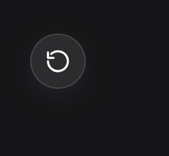
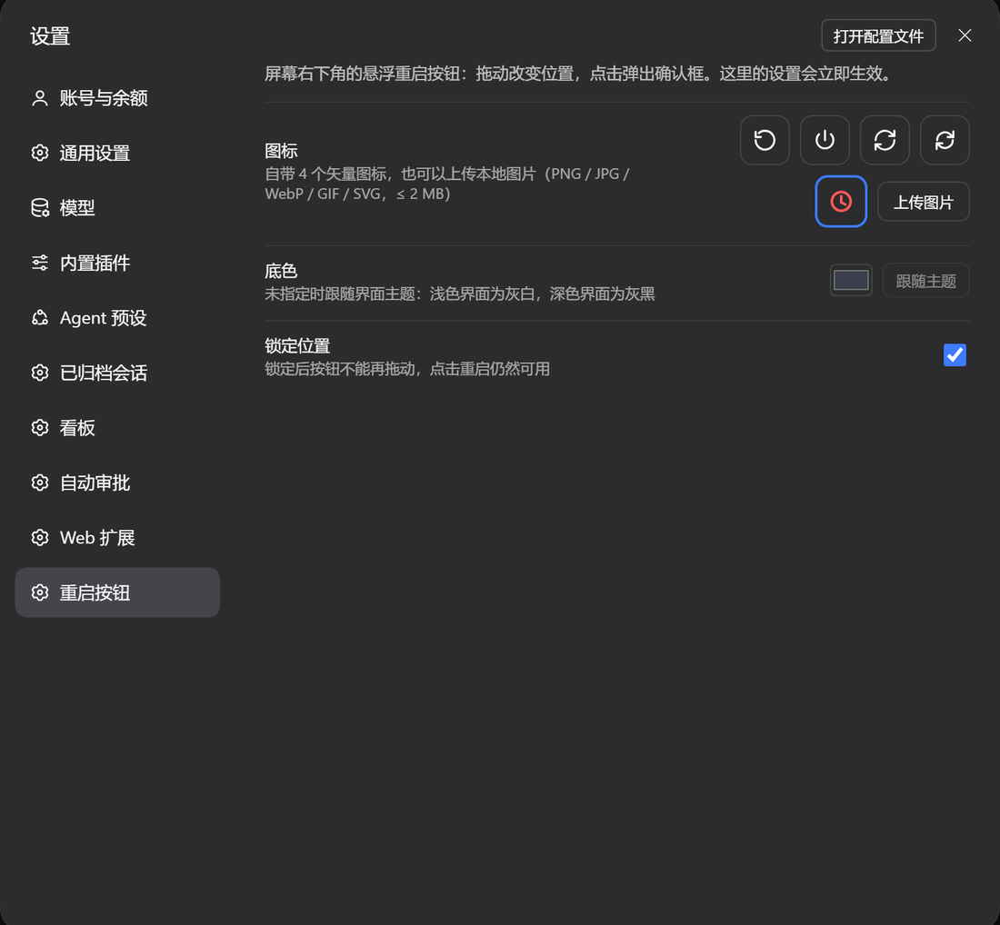
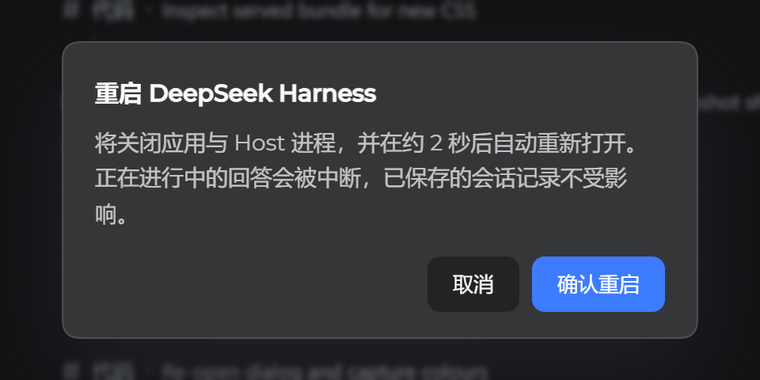

# dsh-restart-button

A draggable floating **restart button** for the [DeepSeek Harness](https://github.com/deepseek-ai) (dsh) Web GUI.

Drag it where you want it, click it, confirm — the desktop app and its host process close and come
back by themselves. If the restart cannot happen — a security suite blocks it, or the app simply
refuses to close — the button says so, cleans up after itself, and never leaves you with a spinner.



## Features

- **Draggable** — the button sits in the corner you drag it to; the position is stored in
  `~/.dsh/restart-button.json` and survives a restart.
- **Confirm, then watch** — a click opens a dialog. **Until the close request goes out** you can still
  cancel with **取消重启**; once it has, the cycle is irreversible and the dialog says so. After 45
  seconds without the app closing, the plugin cancels the job itself and tells you why.
- **Custom icon** — four built-in vector glyphs, or upload your own image (PNG / JPG / WebP / GIF / SVG, ≤ 2 MB).
- **Custom background colour** — pick any colour; the glyph switches between dark and light ink
  automatically. Unset, it follows the UI theme.
- **Lockable position** — freeze the button in place so a stray drag cannot move it.
- Everything is editable in **Settings → Restart button** and applies immediately.





## Install

Through the plugin manager: open **插件 / Plugins → 安装插件** and paste the package URL below.
From a terminal, in the profile you use:

```sh
dsh plugin --profile desktop add https://codeload.github.com/NYSM803/dsh-restart-button/tar.gz/refs/heads/main
```

> That URL form needs nothing but pnpm. The `github:NYSM803/dsh-restart-button` shorthand also works,
> but **only when `git` is installed** — pnpm resolves it with `git ls-remote`, and without git the
> install stops with `ERR_PNPM_GIT_RESOLVE_FAILED`.

The host half mounts on the next app start; the browser half after the page reloads.

## How the restart works

`POST /api/restart-button/restart` starts `lib/relauncher.mjs` as a detached process **on the app's
own executable** (`ELECTRON_RUN_AS_NODE`), so no PowerShell and no scheduled task is involved —
those are exactly what Windows security suites block. The launcher:

1. waits 0.3 s, and gives up harmlessly if the UI cancelled in the meantime;
2. asks the app to close once (`taskkill /im`), then escalates to a forced kill every 150 ms until no
   app process is left — **and refuses to start a second instance** if they survive;
3. starts the app again, retrying through `cmd start` and PowerShell when the direct spawn is refused,
   and reports `relaunched` as soon as the new process exists.
The whole cycle is a few seconds; the app's own window then takes a moment to appear.

The host verifies the launcher really started (its first log line) within 1.8 s, so a blocked script
becomes an error dialog instead of a silent no-op. Cancel and status are separate endpoints, and a
45-second watchdog ends a restart that never takes effect.

Logs land in `%LOCALAPPDATA%\dsh-restart-button\relaunch.log`; the last lines are also served by
`GET /api/restart-button/log`.

An in-flight answer is interrupted by the restart; the saved session transcript is not.

## Troubleshooting

| What you see | What it means |
| --- | --- |
| *启动器没有跑起来（多半被 360 / 火绒 之类的安全软件拦下了）* | The launcher process could not start or died immediately. Add the DeepSeek Harness folder to the security software's allowlist and retry. |
| *重启超过 45 秒没有生效，已自动终止* | Nothing closed within the watchdog. The app is untouched; check the log for the launcher's exit codes. |
| *已经发出关闭指令，这次重启无法取消* | The close request is already out; the launcher finishes the cycle so the app cannot be left closed. |
| *the app survived the forced close — not starting a second instance* | The force close was blocked. Nothing was started twice; quit the app by hand and reopen it. |

## If the app closes but does not come back

The launcher only closes the app after it has proven it can run, and it retries the start three ways
(app binary → `cmd start` → PowerShell `Start-Process`). If all three are refused, the log names each
failure and the app stays closed — on those machines Windows security software is blocking process
creation by an unsigned script host.

Add both executables to the allowlist of every security suite you run, then try again:

| Suite | Where |
| --- | --- |
| 360 安全卫士 | 安全防护中心 → 信任区 → 添加目录，加入 `D:\deep seek`（至少 `DeepSeek Harness.exe` 与 `node.exe`） |
| 火绒安全软件 | 防护中心 → 信任区 → 添加文件/目录，加入 `DeepSeek Harness.exe` 和 `…\.dsh\dsh-runtimes\…\dependencies\node\bin\node.exe` |
| Windows Defender | 病毒和威胁防护 → 管理设置 → 排除项 → 添加文件夹 `D:\deep seek` |

Quitting 360 / 火绒 for the duration of a restart also works, but the allowlist is what makes the
button dependable.

The log is `%LOCALAPPDATA%\dsh-restart-button\relaunch.log`; it is rewritten on every attempt, so read
it before clicking again. `GET /api/restart-button/log` returns the same lines.

## Settings

| Field | Effect |
| --- | --- |
| Icon | four built-in glyphs, or an uploaded image stored in `~/.dsh/restart-button/icon.*` |
| Background | any colour, or *follow theme* (the default) |
| Lock position | stops dragging, keeps the click |

## API

| Method | Path | Purpose |
| --- | --- | --- |
| GET / POST | `/api/restart-button/config` | read / merge the configuration |
| GET / POST | `/api/restart-button/icon` | the uploaded icon / upload it as `{"dataUrl":"data:image/png;base64,…"}` |
| POST | `/api/restart-button/restart` | start a restart; `{"dryRun":true}` only resolves the paths |
| GET | `/api/restart-button/status` | job phase: `starting`, `launched`, `done`, `cancelled`, `timeout`, `blocked`, `failed`, `irreversible` |
| POST | `/api/restart-button/cancel` | cancel, unless the close request is already out |
| GET | `/api/restart-button/log` | the last launcher log lines |

## Package layout

```
package.json        declares dsh.bundle (the cordis patch) and dsh.client (the browser half)
cordis.patch.yml    inserts the restart-button row
lib/index.js        host half: config, icon upload, restart job, status/cancel routes
lib/relauncher.mjs  the detached relauncher started on the app's own binary
lib/client.js       browser half: floating button, confirm/cancel dialog, settings page
```

## Requirements

- dsh >= 0.2.2-rc.1, **Windows desktop app only**: the relauncher shells out to `tasklist` / `taskkill` / `cmd` / `powershell` and recognises exactly one process image, `DeepSeek Harness.exe`.
- On a `dsh web` CLI host the button still renders (the browser half is generic) but a restart always fails: there is no desktop process to close and relaunch.
- React 18 is provided by the host.

## License

MIT
