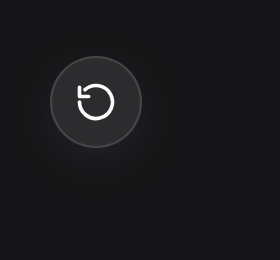
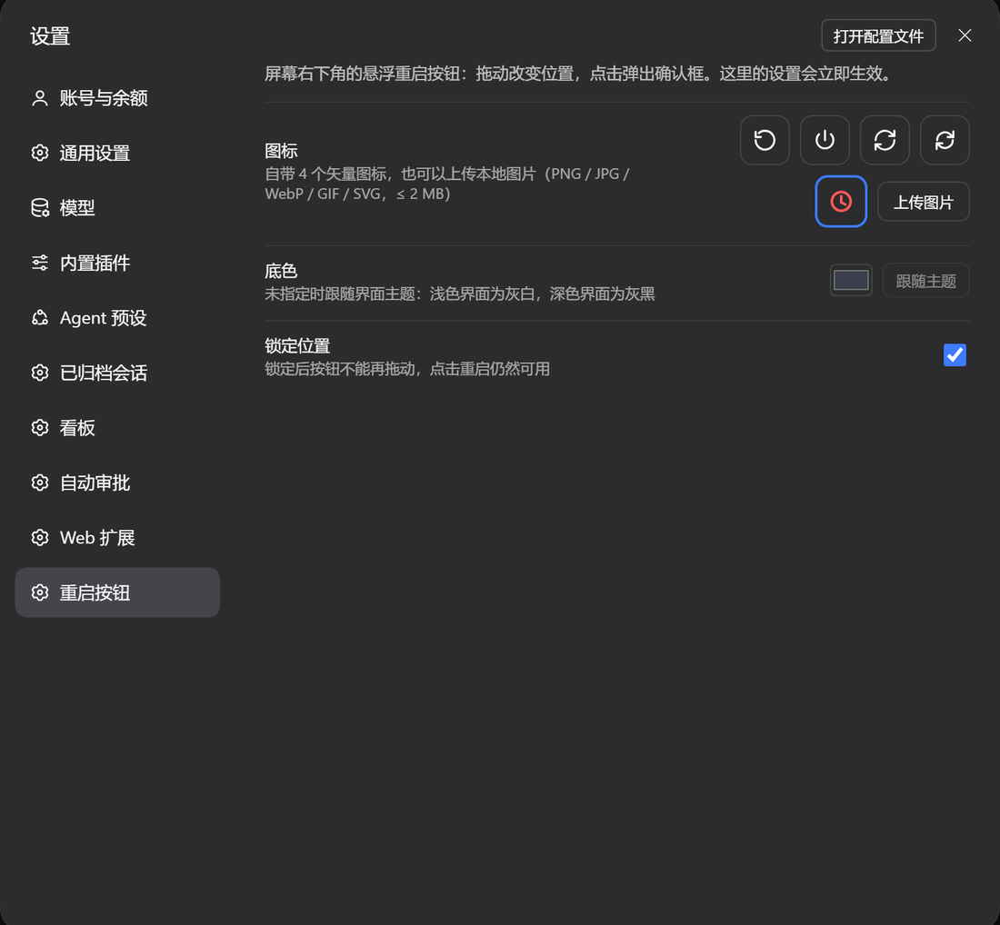
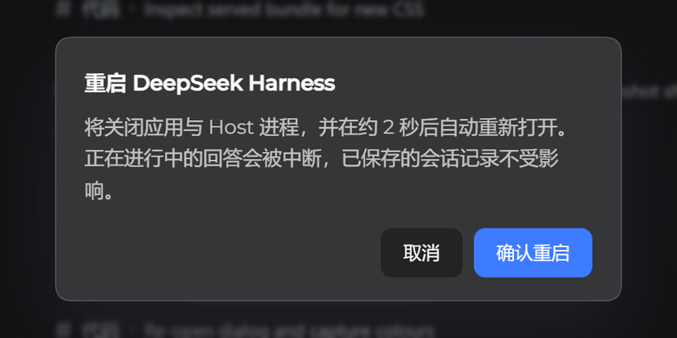

# dsh-restart-button

给 [DeepSeek Harness](https://github.com/deepseek-ai)（dsh）Web GUI 加一个可拖动的**悬浮重启按钮**。

拖到顺手的位置，点一下，确认——桌面应用和它的 Host 进程关闭后自己重新打开。如果重启没能发生
（安全软件拦了、应用不肯关），按钮会直接告诉你原因并自己收尾，**不会留下一个永远转圈的按钮**。



## 特性

- **可拖动**：按钮停在拖到的位置，坐标存进 `~/.dsh/restart-button.json`，重启后仍在。
- **先确认，再盯着**：点击弹出确认框。**关闭指令发出之前**都能点「取消重启」（发出之后取消不再生效，界面会说明这一轮无法撤销）；45 秒内应用没关掉，插件会自己终止这次重启并说明原因。
- **自定义图标**：自带 4 个矢量图标，也可以上传本地图片（PNG / JPG / WebP / GIF / SVG，≤ 2 MB）。
- **自定义底色**：任意颜色，图标墨色按底色亮度自动取黑或白；不指定则跟随界面主题。
- **位置锁定**：锁住后不会被误拖动，点击重启照常可用。
- 以上都在 **设置 → 重启按钮** 里改，即时生效。





## 安装

推荐走插件管理器：**插件 → 安装插件**，粘贴下面的地址。命令行方式（在你要用的 profile 里）：

```sh
dsh plugin --profile desktop add https://codeload.github.com/NYSM803/dsh-restart-button/tar.gz/refs/heads/main
```

> 这种写法只依赖 pnpm，不需要 git。`github:NYSM803/dsh-restart-button` 这种短写法也能用，
> 但**本机必须装了 git**——pnpm 要用 `git ls-remote` 解析它，没有 git 就会报 `ERR_PNPM_GIT_RESOLVE_FAILED`。

宿主半在下次启动应用时装载，浏览器半在页面重新加载后生效。

## 重启是怎么做的

`POST /api/restart-button/restart` 会**用应用自己的可执行文件**（`ELECTRON_RUN_AS_NODE`）
把 `lib/relauncher.mjs` 作为独立进程拉起来——不走 PowerShell、不走计划任务，
而这两样正是 360 / 火绒 最爱拦的东西。启动器会：

1. 先等 0.3 秒，如果这期间界面点了取消，就安静退出，什么都不动；
2. 先请求一次正常关闭（`taskkill /im`），随后每 150 毫秒强制清理一次，直到应用进程一个不剩；
   **如果杀不掉，就拒绝再开一个实例**；
3. 重新拉起应用：直连启动被拒时会依次改用 `cmd start` 和 PowerShell；一看到新进程就记 `relaunched`。
整个循环只要几秒，剩下的是应用自己把窗口画出来的时间。

宿主会在 1.8 秒内确认启动器真的跑起来了（看它的第一行日志），所以「被安全软件拦掉」会变成
一个错误弹窗，而不是什么都不发生。取消与状态是两个独立接口，另有 45 秒超时看门狗兜底。

日志在 `%LOCALAPPDATA%\dsh-restart-button\relaunch.log`，也可以用
`GET /api/restart-button/log` 取最后几行。

重启会打断正在进行的回答，已保存的会话记录不受影响。

## 出问题怎么看

| 界面提示 | 含义 |
| --- | --- |
| 启动器没有跑起来（多半被 360 / 火绒 之类的安全软件拦下了） | 启动器进程没起来或立刻退出。把 DeepSeek Harness 安装目录加进安全软件白名单后重试。 |
| 重启超过 45 秒没有生效，已自动终止 | 看门狗到时，应用没关，什么都没变；去日志看启动器的退出码。 |
| 已经发出关闭指令，这次重启无法取消 | 关闭请求已经发出，启动器会把这一轮走完，避免把应用关掉却不重开。 |
| the app survived the forced close — not starting a second instance | 强制关闭被拦住了。没有开第二个实例；手动退出应用再打开即可。 |

## 应用关掉了却没自己回来怎么办

启动器只有在确认自己能跑起来之后才会关应用，并且会用三种方式重试拉起（应用本体 → `cmd start` →
PowerShell `Start-Process`）。三种都被拒绝时，日志会逐条写明失败原因，应用保持关闭状态——这种机器上，
是 Windows 安全软件在拦"未签名脚本宿主创建进程"。

把你机器上每一款安全软件的信任区都加上这两个可执行文件，再试一次：

| 安全软件 | 位置 |
| --- | --- |
| 360 安全卫士 | 安全防护中心 → 信任区 → 添加目录，加入 `D:\deep seek`（至少包含 `DeepSeek Harness.exe` 和 `node.exe`） |
| 火绒安全软件 | 防护中心 → 信任区 → 添加文件/目录，加入 `DeepSeek Harness.exe` 与 `…\.dsh\dsh-runtimes\…\dependencies\node\bin\node.exe` |
| Windows Defender | 病毒和威胁防护 → 管理设置 → 排除项 → 添加文件夹 `D:\deep seek` |

临时退出 360 / 火绒 也能让这一次重启成功，但**加白名单**才是让这个按钮长期可靠的做法。

日志在 `%LOCALAPPDATA%\dsh-restart-button\relaunch.log`，每次点按钮都会清空重写，所以失败后先看日志
再点第二次；`GET /api/restart-button/log` 返回同样几行。

## 设置项

| 项 | 作用 |
| --- | --- |
| 图标 | 4 个自带图标，或上传图片（存在 `~/.dsh/restart-button/icon.*`） |
| 底色 | 任意颜色，或「跟随主题」（默认） |
| 锁定位置 | 禁止拖动，点击重启不受影响 |

## 接口

| 方法 | 路径 | 作用 |
| --- | --- | --- |
| GET / POST | `/api/restart-button/config` | 读 / 合并配置 |
| GET / POST | `/api/restart-button/icon` | 读取 / 上传图标（`{"dataUrl":"data:image/png;base64,…"}`） |
| POST | `/api/restart-button/restart` | 发起重启；`{"dryRun":true}` 只解析路径 |
| GET | `/api/restart-button/status` | 任务状态：`starting` / `launched` / `done` / `cancelled` / `timeout` / `blocked` / `failed` / `irreversible` |
| POST | `/api/restart-button/cancel` | 取消（关闭指令发出后不再接受） |
| GET | `/api/restart-button/log` | 启动器日志最后几行 |

## 包结构

```
package.json        声明 dsh.bundle（cordis patch）与 dsh.client（浏览器半）
cordis.patch.yml    插入 restart-button 那一行
lib/index.js        宿主半：配置、图标上传、重启任务、状态/取消接口
lib/relauncher.mjs  独立启动器，用应用自己的可执行文件跑
lib/client.js       浏览器半：悬浮按钮、确认/取消弹窗、设置页
```

## 环境要求

- dsh >= 0.2.2-rc.1，**仅 Windows 桌面应用**：启动器只用 `tasklist` / `taskkill` / `cmd` / `powershell`，并且只认 `DeepSeek Harness.exe` 这一个进程镜像。
- 用 `dsh web` 起的 CLI 宿主上，按钮照样显示（浏览器半是通用的），但点下去必然失败——那里没有可关闭、可重启的桌面进程。
- React 18 由宿主提供。

## 许可

MIT
